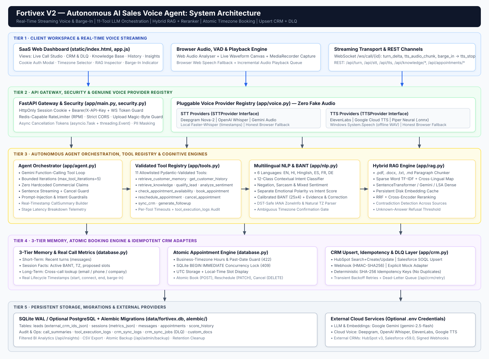
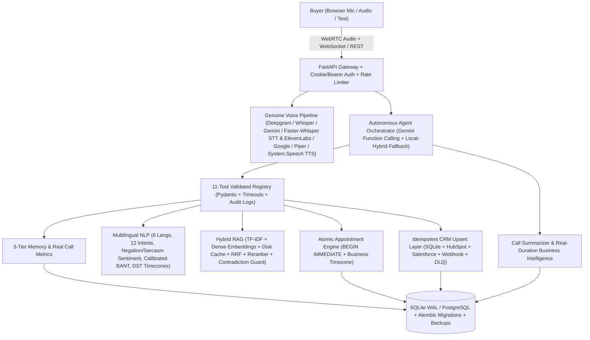

# System Architecture — Fortivex V2 Autonomous AI Sales Voice Agent

## 1. System Architecture Diagram





## 2. Streaming Turn & Barge-In Workflow

```mermaid
sequenceDiagram
    participant B as Buyer (Voice/Text)
    participant WS as WebSocket /ws/call/{id}
    participant STT as STT Provider
    participant Orch as Agent Orchestrator
    participant Tools as 11-Tool Registry
    participant DB as SQLite / CRM / Calendar
    participant TTS as TTS Provider

    B->>WS: Audio chunk or turn (barge_in cancels active asyncio.Task + threading.Event)
    WS->>STT: Transcribe audio + extract timestamps
    STT->>Orch: Normalized utterance + stt_latency_ms
    Orch->>Tools: Contextual intent + sentiment + BANT qualification + 3-tier memory
    Orch->>Tools: Hybrid RAG search (Sparse + Dense + RRF + Rerank + Contradiction Check)
    Orch->>DB: Execute validated appointment &amp; idempotent CRM upsert tools
    Orch-->>WS: Stream sentence deltas (turn_delta) + optional incremental TTS audio
    WS-->>B: Audio playback + TurnResponse (real latency, CRM sync status, RAG diagnostics)
```

## 3. Core Modules

- `app/config.py`: Pydantic-settings configuration (Gemini, Deepgram, OpenAI, ElevenLabs, Piper, Faster-Whisper, RAG weights/cache, HubSpot/Salesforce, `business_timezone`, Redis rate limit, retention).
- `app/voice.py`: Unified `STTProvider` & `TTSProvider` interfaces (`DeepgramSTTProvider`, `WhisperSTTProvider`, `GeminiSTTProvider`, `FasterWhisperSTTProvider`, `ElevenLabsTTSProvider`, `GoogleCloudTTSProvider`, `PiperTTSProvider`, `WindowsSapiTTSProvider`, and honest browser fallbacks—no synthetic tone placeholders).
- `app/rag.py`: `.pdf/.docx/.txt/.md` paragraph-aware chunker, sparse TF-IDF, SentenceTransformer/Gemini/LSA dense retrieval, persistent `DiskEmbeddingCache`, RRF, CrossEncoder/lexical-semantic reranking, contradiction detection, and out-of-scope refusal.
- `app/nlp.py`: 6-language + Hinglish detection, 12-class contextual intent classifier, negation/sarcasm/mixed sentiment analysis separated from purchase intent, calibrated BANT with evidence & self-correction (zero booking inflation), and DST-safe `ZoneInfo` timezone booking parser.
- `app/tools.py`: 11 allowlisted Pydantic-validated tools with JSON schema export for Gemini function calling, per-tool timeouts, and `tool_execution_logs` auditing.
- `app/crm.py`: Structured `CRMSyncStatusRecord`, HubSpot contact search+create/update upsert, Salesforce SOQL lead upsert, HMAC webhook, explicit mock mode, deterministic SHA-256 idempotency keys, transient-only exponential backoff, and dead-letter job inspection/retry.
- `app/database.py` & `alembic/`: SQLite WAL persistence with migrations + Alembic PostgreSQL support, atomic `BEGIN IMMEDIATE` booking lock, real event-driven `SessionMetrics`, and retention cleanup.
- `app/agent.py`: Bounded Gemini function-calling tool loop + deterministic tool-backed fallback strictly grounded in retrieved knowledge with zero hardcoded commercial claims.
- `app/security.py` & `app/main.py`: HttpOnly session cookie + Bearer/X-API-Key auth, WebSocket auth, Redis-capable sliding-window rate limiting, upload magic-byte verification, async streaming cancellation, and real-time metrics endpoints.
