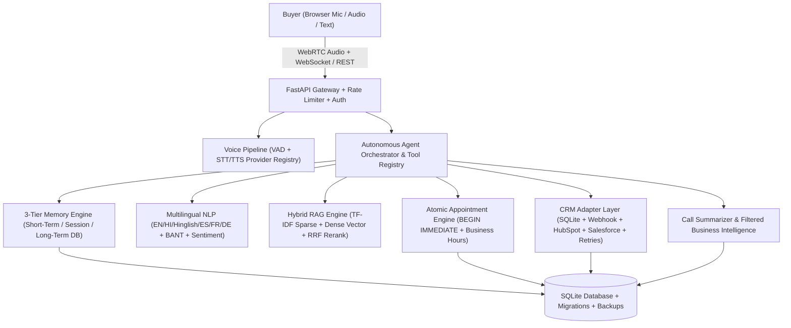
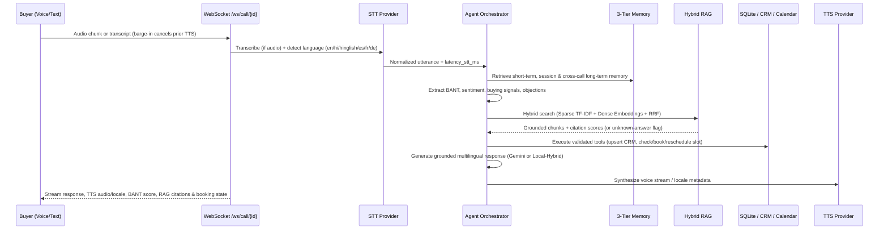

# System Architecture — Fortivex Autonomous AI Sales Voice Agent

## 1. High-Level Architecture

Fortivex is organized as a modular FastAPI + WebSocket voice & revenue automation platform backed by SQLite, a Hybrid Dense+Sparse RAG engine, deterministic BANT + Sentiment NLP, an audited Tool Orchestrator, and pluggable Voice & CRM provider adapters.

## 2. End-to-End Conversational Turn Workflow

## 3. Core Modules

- `app/config.py`: Environment-driven configuration (`pydantic-settings`), provider keys, security/CORS/rate-limit settings.
- `app/voice.py`: Abstract `STTProvider` & `TTSProvider` interfaces with implementations for Gemini Multimodal, OpenAI/Whisper-compatible, Deepgram, ElevenLabs, and Local/Browser fallback.
- `app/rag.py`: Document ingestion (`.pdf`, `.docx`, `.txt`, `.md`), semantic chunking, sparse TF-IDF + dense semantic embeddings (`sentence-transformers` / Gemini / local `TruncatedSVD` LSI), Reciprocal Rank Fusion, and grounded citation enforcement.
- `app/nlp.py`: 6-language + Hinglish code-switching detection, deterministic BANT + `Disqualified` scoring, sentiment vs purchase-intent separation, and timezone-aware appointment parsing.
- `app/tools.py`: Structured Pydantic tool definitions, permission checks, execution wrapper, and persistent `tool_execution_logs`.
- `app/crm.py`: Pluggable CRM integration layer (`LocalSQLiteCRM`, `WebhookCRM`, `HubSpotCRM`, `SalesforceCRM`) with exponential backoff retries, timeouts, idempotency keys, and delivery audit logs.
- `app/database.py`: SQLite schema management with versioned migrations, atomic `BEGIN IMMEDIATE` appointment locking, `score_history`, `call_activities`, filtered analytics, and backup utilities.
- `app/agent.py`: Autonomous orchestrator uniting memory retrieval, tool selection, grounded LLM/hybrid generation, and structured call report generation.
